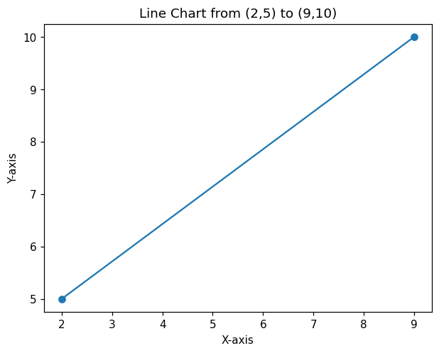
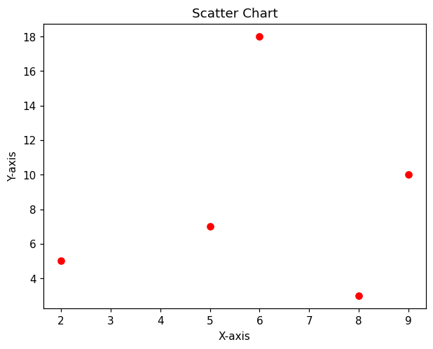
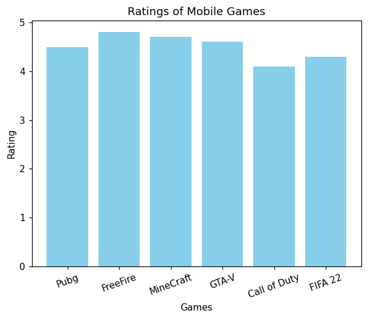
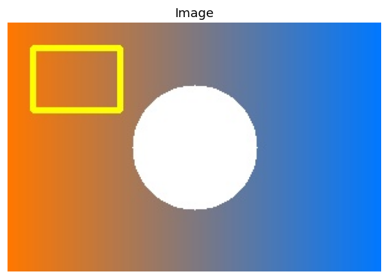

<div align="center">


<a href="https://github.com/<your-username>/AI_Class10_Practical">
  
</a>

<br>


**By Takshil Pardeshi** &nbsp;•&nbsp; *Made possible by **FollowFlow***

</div>

<br>

<!-- ====================== FOLLOWFLOW PROMO ====================== -->

<div align="center">


### 🚀 Want Automation & Marketing Services for Your Business?


<a href="https://your-followflow-website.com">
  
</a>
<a href="mailto:your-email@example.com">
  
</a>

**Need automation or marketing services? Contact [FollowFlow](https://your-followflow-website.com).**


</div>

<br>

## 📖 About

This repository is my **Artificial Intelligence (Class 10) practical record file**. It contains **22 beginner-friendly Python programs** covering the syllabus topics:

| | Topic | What's covered |
|:-:|-------|----------------|
| 🐍 | **Python basics** | lists, loops, conditions, user input |
| 🔢 | **NumPy** | arrays, matrices, mean, median, mode, variance, standard deviation |
| 🐼 | **Pandas** | DataFrames, reading CSV files, filtering data |
| 📊 | **Matplotlib** | line chart, scatter chart, bar chart |
| 🖼️ | **Computer Vision basics** | reading, displaying and finding the shape of an image with OpenCV |

> ✨ Every program is commented line by line, so it is easy to understand and explain in a viva.

---

## 📑 Table of Contents

[Programs](#-programs) • [Project Structure](#-project-structure) • [Getting Started](#-getting-started) • [Sample Output](#-sample-output) • [Tech Stack](#-tech-stack) • [Author](#-author) • [Credits](#-credits) • [License](#-license)

---

## 📝 Programs

> 👇 Click a section to expand it.

<details open>
<summary><b>🐍 Python basics</b> (8 programs)</summary>
<br>

| No. | Program | File |
|:---:|---------|------|
| 1 | Add the elements of two lists | [`prog01_add_lists.py`](programs/prog01_add_lists.py) |
| 9 | Display the first ten even natural numbers | [`prog09_first_ten_even.py`](programs/prog09_first_ten_even.py) |
| 10 | Read name and marks of a student, display total | [`prog10_student_total_marks.py`](programs/prog10_student_total_marks.py) |
| 11 | Find if a triangle is equilateral, isosceles or scalene | [`prog11_triangle_type.py`](programs/prog11_triangle_type.py) |
| 12 | Tipper program (15% and 20% tip) | [`prog12_tipper.py`](programs/prog12_tipper.py) |
| 13 | Calculate Net Salary (Basic + HRA + DA − PF) | [`prog13_net_salary.py`](programs/prog13_net_salary.py) |
| 14 | Display the series 1, 4, 7, 10 … n | [`prog14_series_1_4_7.py`](programs/prog14_series_1_4_7.py) |
| 15 | Sum of numerical values in a list | [`prog15_sum_of_list.py`](programs/prog15_sum_of_list.py) |

</details>

<details>
<summary><b>🔢 Statistics & data (Unit 4)</b> (7 programs)</summary>
<br>

| No. | Program | File |
|:---:|---------|------|
| 2 | Mean, median and mode using NumPy | [`prog02_mean_median_mode.py`](programs/prog02_mean_median_mode.py) |
| 16 | Create a 2D array using NumPy | [`prog16_numpy_2d_array.py`](programs/prog16_numpy_2d_array.py) |
| 17 | Convert a Python list to a NumPy array | [`prog17_list_to_numpy.py`](programs/prog17_list_to_numpy.py) |
| 18 | Create a 3×3 matrix using NumPy | [`prog18_matrix_3x3.py`](programs/prog18_matrix_3x3.py) |
| 19 | DataFrame of interview candidates (index C001, C002 …) | [`prog19_candidates_dataframe.py`](programs/prog19_candidates_dataframe.py) |
| 20 | Player DataFrame, show players with runs > 1000 | [`prog20_player_dataframe.py`](programs/prog20_player_dataframe.py) |
| 22 | Variance and standard deviation | [`prog22_variance_std.py`](programs/prog22_variance_std.py) |

</details>

<details>
<summary><b>📊 Data visualisation</b> (3 programs)</summary>
<br>

| No. | Program | File |
|:---:|---------|------|
| 3 | Line chart from (2,5) to (9,10) | [`prog03_line_chart.py`](programs/prog03_line_chart.py) |
| 4 | Scatter chart for given points | [`prog04_scatter_chart.py`](programs/prog04_scatter_chart.py) |
| 21 | Bar chart of mobile game ratings | [`prog21_game_ratings_barchart.py`](programs/prog21_game_ratings_barchart.py) |

</details>

<details>
<summary><b>🖼️ Working with files (CSV and images)</b> (4 programs)</summary>
<br>

| No. | Program | File |
|:---:|---------|------|
| 5 | Read a CSV file and display 10 rows | [`prog05_read_csv_10_rows.py`](programs/prog05_read_csv_10_rows.py) |
| 6 | Read a CSV file and display its information | [`prog06_csv_information.py`](programs/prog06_csv_information.py) |
| 7 | Read an image and display it | [`prog07_read_display_image.py`](programs/prog07_read_display_image.py) |
| 8 | Read an image and identify its shape | [`prog08_image_shape.py`](programs/prog08_image_shape.py) |

</details>

---

## 📂 Project Structure

```
AI_Class10_Practical/
├── 📁 programs/          # all 22 Python programs
├── 📁 data/
│   ├── students.csv       # sample CSV used by programs 5 and 6
│   └── sample_image.jpg   # sample image used by programs 7 and 8
├── 📁 assets/            # chart previews used in this README
├── 📄 requirements.txt
├── 📄 CREDITS.md
├── 📄 LICENSE
└── 📄 README.md
```

---

## 🚀 Getting Started

**1️⃣ Clone the repository**
```bash
git clone https://github.com/<your-username>/AI_Class10_Practical.git
cd AI_Class10_Practical
```

**2️⃣ Install the libraries**
```bash
pip install -r requirements.txt
```

**3️⃣ Run a program** (open the terminal inside the `programs` folder, because programs 5 to 8 read files from `../data/`)
```bash
cd programs
python prog01_add_lists.py
```

> 💡 Programs 10 to 15 ask for input, so type the values when prompted. For program 15, enter items separated by commas, like `10, apple, 20.5, 7`.

> 💡 To use your own CSV file or image in programs 5 to 8, put it in the `data` folder and change the file name inside the program.

---

## 🖼️ Sample Output

<table>
<tr>
<td width="50%" valign="top">

**Program 22: Variance and standard deviation**
```
Mean: 47.95
Variance: 416.58
Standard Deviation: 20.41
```

</td>
<td width="50%" valign="top">

**Program 18: 3×3 matrix**
```
[[11 12 13]
 [14 15 16]
 [17 18 19]]
```

</td>
</tr>
<tr>
<td width="50%" valign="top">

**Program 11: Triangle type** (sides 5, 5, 8)
```
It is an Isosceles triangle (two sides equal).
```

</td>
<td width="50%" valign="top">

**Program 13: Net Salary** (Basic = 50000)
```
HRA        : 15000.0
DA         : 10000.0
PF         : 6000.0
Net Salary : 69000.0
```

</td>
</tr>
</table>

### 📈 Charts

<div align="center">

| Line chart (Program 3) | Scatter chart (Program 4) |
|:---:|:---:|
|  |  |

| Bar chart (Program 21) | Image display (Program 7) |
|:---:|:---:|
|  |  |

</div>

---

## 🛠️ Tech Stack

<div align="center">


</div>

| Tool | Used for |
|------|----------|
| **Python 3** | Core language |
| **NumPy** | Arrays, matrices, statistics |
| **Pandas** | DataFrames and CSV files |
| **Matplotlib** | Line, scatter and bar charts, displaying images |
| **OpenCV** | Reading images and finding their shape |

---

## 👤 Author

<div align="center">

**Takshil Pardeshi**
🎓 Class 10 | Artificial Intelligence

</div>

---

## 🙌 Credits

This project was made possible by **[FollowFlow](https://your-followflow-website.com)**.

---

## 📄 License

Released under the [MIT License](LICENSE). Free to learn from and reuse.

---

<div align="center">

### 💼 Need Automation & Marketing Services?
**[Contact FollowFlow](https://your-followflow-website.com)** &nbsp;|&nbsp; **[✉️ Email us](mailto:your-email@example.com)**

<br>

⭐ If this helped you with your practicals, consider giving the repo a star!


*Made possible by **FollowFlow***

</div>
